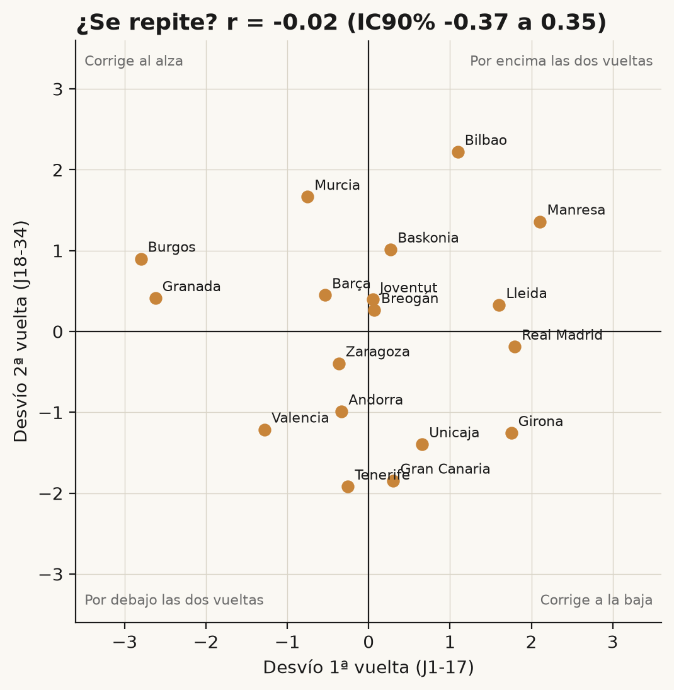
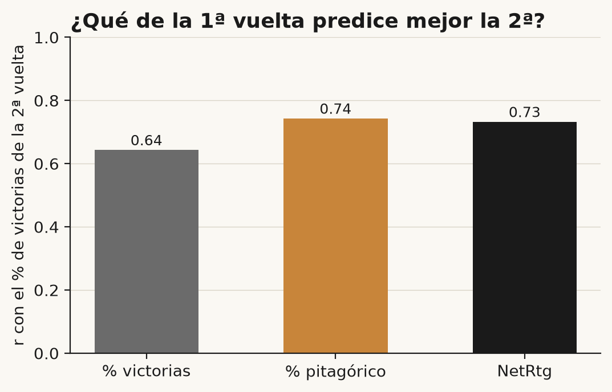

# ¿Suerte o habilidad? Cuántas victorias merece cada equipo de la ACB

BAXI Manresa ganó 16 partidos en la liga regular 2025/26. Sus puntos a favor y en contra, en cambio, eran los de un equipo de unas 12 victorias. Es el mayor desvío positivo de la ACB esa temporada: **+3,6 victorias** sobre lo esperado. Valencia Basket, con 25 triunfos, hizo lo contrario: sus puntos valían 27,6 y se quedó 2,5 por debajo.

La pregunta es qué hay detrás. ¿Ganar por encima de lo que dicen tus puntos es una habilidad que se repite, de esos equipos que saben cerrar los finales, o es ruido de 34 partidos?

No voy a empezar por el veredicto. Voy a contar cómo lo medí, que fijé las reglas antes de mirar y que lo que sigue no es un titular de «+N victorias»: ese desvío de Manresa, como verás, **cae dentro de lo que el azar produce solo**.

## Qué es la expectativa pitagórica

Bill James observó en el béisbol que el balance de un equipo se parece mucho a la proporción de carreras que anota frente a las que encaja:

> % de victorias esperado = PF^k / (PF^k + PC^k)

donde PF son los puntos a favor, PC los puntos en contra y k un exponente. En béisbol k ronda 2. Daryl Morey adaptó la idea al baloncesto y el valor que se cita para la NBA es k ≈ 14.

¿Por qué tan alto? Porque en baloncesto hay muchas posesiones por partido: cada una es un pequeño sorteo y, con tantos, el mejor equipo gana con más regularidad que en béisbol. Una pequeña ventaja de puntos se traduce en muchas más victorias. Esa es la intuición; no es una demostración.

Que en la ACB el exponente salga distinto del de la NBA es **una hipótesis**, no un hecho. La liga juega 40 minutos en lugar de 48, tiene otro ritmo y otra dispersión de niveles. Lo comprobaremos.

Con k, las **victorias esperadas** son los partidos jugados por el porcentaje pitagórico, y el **desvío** es la diferencia entre victorias reales y esperadas.

## Datos y reglas fijadas de antemano

Los datos son la liga regular ACB 2025/26: 306 partidos, 18 equipos, 34 partidos cada uno, sin empates. Es **la única temporada que uso**. No hay series históricas en este análisis y no invento ninguna: todo lo que sigue es de una sola temporada y se dice cuando importa. Como todos los equipos jugaron 34 partidos, no hace falta normalizar nada. Quedan fuera playoffs, Supercopa y Copa. Los puntos de las prórrogas cuentan.

Antes de calcular nada fijé por escrito, en un documento con fecha, las definiciones, los tests y la regla de decisión, incluidas las **dos conclusiones posibles ya redactadas**. Está en el commit [`c0c12be`](../docs/preregistro.md) del repositorio, anterior a cualquier cálculo. Contar esto no es postureo: en el historial de git se puede comprobar. Lo resumo:

- **Partido igualado:** decidido por 5 puntos o menos, o que fue a prórroga (91 de 306, de los que 11 con prórroga).
- **Vueltas:** primera, jornadas 1-17; segunda, jornadas 18-34.
- **Test A:** correlación entre el desvío de la primera y el de la segunda vuelta, con intervalo de confianza al 90 % por bootstrap sobre equipos.
- **Test B:** la dispersión de los desvíos de la temporada completa frente a la de temporadas simuladas puramente al azar.
- **Regla de decisión:** concluyo «hay señal de habilidad» **solo si se cumplen los dos tests** (el intervalo de A queda por encima de 0 y el p-valor de B es menor de 0,10). Si no, «compatible con el azar».
- **Titular «+N victorias»:** solo si ese desvío queda fuera de la banda del azar.

Una limitación honesta de partida: con 18 equipos el test tiene poca potencia. Si sale «compatible con el azar», eso **no** demuestra que sea suerte.

## Calibrar k para la ACB

Ajusté k por mínimos cuadrados sobre el porcentaje de victorias de los 18 equipos. Resultado:

- **k = 11,3**, con un intervalo al 90 % (bootstrap de partidos) de **9,8 a 13,3**.
- Con ese k, el error medio es de **1,51 victorias por equipo**. Con el 14 de la NBA es de 1,55.

El 14 queda justo fuera del intervalo. Pero mira la curva: entre 10 y 14 el error apenas cambia, y la diferencia entre ambos exponentes es de unas 0,04 victorias por equipo. No es una diferencia que importe en la práctica.

Como solo tengo una temporada, el k es **in-sample** y lo valido de dos formas:

- **Mitades cruzadas.** Ajusto k en una vuelta y mido el error en la otra. k sale 11,5 y 12,1 en cada vuelta; el error medio es de 1,03 victorias frente a 1,13 con k = 14.
- **Dejar un equipo fuera.** Ajusto k con 17 equipos y mido el error en el excluido: 1,60 con el k de la ACB y 1,55 con k = 14. Aquí gana el 14.

Lectura prudente: k para la ACB parece estar entre 11 y 13, probablemente algo por debajo del de la NBA, pero **una temporada no basta para afirmar que difiere de 14**. Usaré 11,3 y lo declaro como estimación de este conjunto de datos. Para el resto del artículo, la conclusión no depende de esa elección.

## La 25/26, equipo por equipo

La siguiente tabla recoge victorias reales, esperadas con k = 11,3 y desvío. La **banda del azar** viene de simular 10.000 temporadas partido a partido sobre el calendario real: la probabilidad de cada partido sale de la fuerza pitagórica de ambos equipos (método log5) y de una ventaja de campo calibrada para reproducir el 58,8 % de victorias locales observado. La banda recoge del percentil 5 al 95 de las victorias simuladas.

| Equipo | V | Esperadas | Desvío | Banda del azar (90 %) |
|---|---:|---:|---:|---:|
| Manresa | 16 | 12,4 | +3,6 | 9 – 17 |
| Bilbao | 19 | 15,7 | +3,3 | 12 – 20 |
| Lleida | 12 | 9,7 | +2,3 | 6 – 14 |
| Real Madrid | 26 | 24,5 | +1,5 | 20 – 28 |
| Baskonia | 25 | 23,7 | +1,3 | 19 – 27 |
| Murcia | 25 | 24,1 | +0,9 | 19 – 28 |
| Girona | 14 | 13,5 | +0,5 | 10 – 18 |
| Joventut | 22 | 21,6 | +0,4 | 17 – 25 |
| Breogán | 15 | 14,7 | +0,3 | 11 – 19 |
| Barça | 24 | 24,1 | −0,1 | 19 – 27 |
| Zaragoza | 10 | 10,6 | −0,6 | 7 – 16 |
| Unicaja | 17 | 17,7 | −0,7 | 13 – 22 |
| Andorra | 10 | 11,2 | −1,2 | 8 – 16 |
| Gran Canaria | 10 | 11,5 | −1,5 | 8 – 16 |
| Burgos | 12 | 13,9 | −1,9 | 10 – 19 |
| Tenerife | 18 | 20,2 | −2,2 | 16 – 24 |
| Granada | 6 | 8,2 | −2,2 | 5 – 13 |
| Valencia | 25 | 27,6 | −2,5 | 23 – 30 |

**Ningún equipo queda fuera de la banda.** Con 18 equipos y un 90 %, se esperaría que un par de ellos salieran por azar puro; salieron cero. Por la regla que fijé, eso significa que no hay titular de «+N victorias»: el desvío de Manresa es **compatible con el azar**.

Qué pasó en los partidos igualados, como **descripción y no como explicación**: Manresa fue 6-4 en ellos, Bilbao 8-5 y Lleida 4-4. En cambio, Valencia fue 5-3 y Tenerife 5-7. Entre equipos, el desvío y el balance en igualados se parecen (correlación de 0,58), lo cual era de esperar: el desvío se construye precisamente a partir de victorias que los puntos no explican, y muchas de ellas se deciden en partidos ajustados. No dice si esos finales se ganan por saber o por suerte.

## ¿Se repite?

Esta es la pregunta de verdad. Si ganar por encima de los puntos fuera una habilidad, los equipos con desvío positivo en la primera vuelta deberían repetirlo en la segunda.

**Test A.** La correlación entre el desvío de la primera vuelta y el de la segunda es **r = −0,02**, con un intervalo al 90 % de **−0,37 a +0,35**. Es compatible con cero, y también con una relación moderada en cualquiera de los dos sentidos. Manresa, Bilbao y Lleida, los tres mayores desvíos de la temporada, fueron positivos en las dos vueltas (+2,1, +1,1 y +1,6 en la primera; +1,4, +2,2 y +0,3 en la segunda). Pero Burgos y Granada pasaron de muy negativos a positivos, y Girona y Real Madrid, de claramente positivos a negativos o nulos. En conjunto, la nube de puntos no tiene forma.

**Test B.** La dispersión de los desvíos (raíz del desvío cuadrático medio) es de 1,80 victorias. En las 10.000 ligas simuladas por azar la mediana es 2,55 y el percentil 95, 3,30. La dispersión observada **no supera** la del azar (p = 0,96). Esto tiene una trampa que conviene decir: la fuerza de cada equipo en la simulación sale de los mismos puntos de esta temporada, y esos puntos ya contienen parte de la suerte. Eso encoge los desvíos observados y hace al test conservador. No lo corrijo después de ver el resultado, porque no era la regla fijada, pero lo cuento.

**Decisión pre-registrada:** el límite inferior del intervalo de A no supera 0 y el p-valor de B no baja de 0,10. No se cumple ninguna de las dos condiciones. La conclusión es:

> Con los datos de la ACB 25/26 no podemos distinguir los desvíos de lo que produciría el azar: la repetición entre vueltas no es distinguible de cero y la dispersión es la esperable de una liga aleatoria. Eso no demuestra que sea suerte: con 18 equipos y 34 partidos el test tiene poca potencia. Lo prudente es esperar que los equipos que ganaron por encima de sus puntos se acerquen a ellos.

## Qué significa y qué no

Que los finales se entrenan es una evidencia. Hay jugadas específicas, decisiones de tiempos muertos y gestión de faltas. Los entrenadores trabajan eso, y este análisis no dice lo contrario. Dice algo más estrecho: **si ese trabajo deja huella en el balance, es pequeña o no la detectamos con una temporada de 18 equipos**.

Otro resultado merece mención. Sospechaba que el **NetRtg** (diferencial por 100 posesiones) predeciría mejor que los puntos brutos. Lo probé: con los datos de la primera vuelta, la correlación con el porcentaje de victorias de la segunda es de 0,64 para el porcentaje de victorias, 0,74 para el pitagórico y 0,73 para el NetRtg.

Pitagórico y NetRtg predicen algo mejor que el balance, pero los intervalos de la diferencia incluyen el cero (pitagórico menos victorias: de −0,01 a +0,20), y entre ellos dos no hay diferencia apreciable (−0,01). **No puedo decir que el NetRtg sea mejor que el pitagórico**; los dos son casi equivalentes y ambos algo mejores que mirar las victorias, con evidencia débil.

Limitaciones:

- **Una temporada y 18 equipos.** Poca potencia: un efecto real de tamaño moderado podría no verse.
- **Cambios de plantilla y de entrenador** durante la temporada. Comparar dos vueltas supone que el equipo es el mismo, y no siempre lo es.
- **Prórrogas.** Sus puntos cuentan en PF y PC; son 11 partidos y su efecto es pequeño, pero existe.
- **El k es in-sample.** Se ha ajustado con los mismos datos que se evalúan.
- **Posesiones estimadas** con la fórmula estándar, no contadas.

## Predicción para la 26/27

Si el desvío fuera sobre todo ruido, lo esperable es que los equipos se acerquen a lo que dicen sus puntos. Mi predicción, solo con datos de la 25/26:

- **Deberían bajar hacia sus puntos:** Manresa (16 victorias frente a 12,4 esperadas), Bilbao (19 frente a 15,7) y Lleida (12 frente a 9,7).
- **Deberían subir:** Valencia (25 frente a 27,6), Tenerife (18 frente a 20,2) y Granada (6 frente a 8,2).

Con la salvedad de que las plantillas cambian, y mucho, de un año a otro. Esta predicción no usa nada de lo ya jugado en la 26/27. **Lo revisaré en enero** con el mismo método, sin retocarlo.

## Recurso y código

La tabla de victorias esperadas de la 25/26 para los 18 equipos, con sus bandas, está en CSV: [PENDIENTE: enlace a la entrega en la newsletter de Basketmática].

El código completo es público y reproducible, con los datos de partido incluidos: [repositorio en GitHub, PENDIENTE: URL]. El notebook (`notebooks/metodo.ipynb`) reproduce todas las cifras de este artículo, y el pre-registro está en `docs/preregistro.md`. Las clasificaciones y los resultados son datos públicos.
